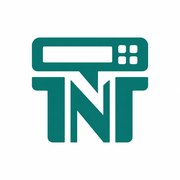
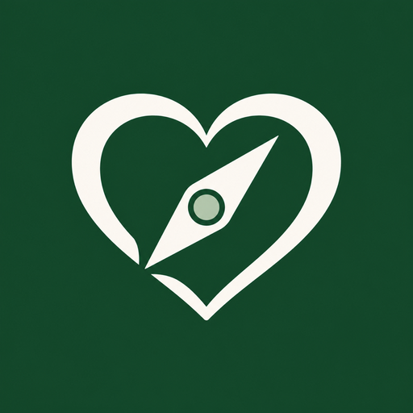

<h1 align="center">Ramy Basily</h1>

Data Architect in the airline industry.

  
  

My day job is helping organizations make their data trusted, discoverable and AI-ready. On my own time, I build products that exist for a reason. Each one started with a real need: faith, health, family and community, and owning your own AI context.

<table>
  <tr>
    <td align="center" valign="top" width="50%">
      
       
      <b><a href="https://ramybassem.github.io/products/scrollscripture/">ScrollScripture</a></b>
       
      <em>Read. Reflect. Grow.</em>
       
      Daily Scripture and reflections in English, Arabic and French.
       
      
        <a href="https://ramybassem.github.io/products/scrollscripture/">Live page</a>
        ·
        <a href="https://scrollscripture.life">scrollscripture.life</a>
      
    </td>
    <td align="center" valign="top" width="50%">
      
       
      <b><a href="https://ramybassem.github.io/products/tntcalc/">TNTCalc</a></b>
       
      <em>Simple. Fast. Built for T&amp;T.</em>
       
      A free trampoline and tumbling difficulty calculator for my sons and their community.
       
      
        <a href="https://ramybassem.github.io/products/tntcalc/">Live page</a>
        ·
        <a href="https://tntcalc.com">tntcalc.com</a>
      
    </td>
  </tr>
  <tr>
    <td align="center" valign="top" width="50%">
      
       
      <b><a href="https://ramybassem.github.io/products/memsynk/">MemSynk</a></b>
       
      <em>Your AI. In sync. Always.</em>
       
      AI memory you own, shared across ChatGPT, Grok, Cursor and more.
       
      
        <a href="https://ramybassem.github.io/products/memsynk/">Live page</a>
        ·
        <a href="https://www.memsynk.com">memsynk.com</a>
      
    </td>
    <td align="center" valign="top" width="50%">
      
       
      <b><a href="https://ramybassem.github.io/products/wellness-compass/">Wellness Compass</a></b>
       
      <em>Personal build</em>
       
      A personal health data hub with read-only tools for AI assistants.
       
      
        <a href="https://ramybassem.github.io/products/wellness-compass/">Live page</a>
      
    </td>
  </tr>
  <tr>
    <td colspan="2" align="center">
      
       
      <b><a href="https://ramybassem.github.io/products/aiglo-services/">Aiglo Services</a></b>
       
      <em>Commercial supplies for businesses</em>
       
      The bilingual quote site I built for my sister's commercial supply business.
       
      
        <a href="https://ramybassem.github.io/products/aiglo-services/">Live page</a>
        ·
        <a href="https://aigloservices.ca">aigloservices.ca</a>
      
    </td>
  </tr>
</table>

  These are personal projects, independent of my employer, with no shared data, resources or assets. Views are my own.
   
  <a href="https://ramybassem.github.io/about/">About me</a>

